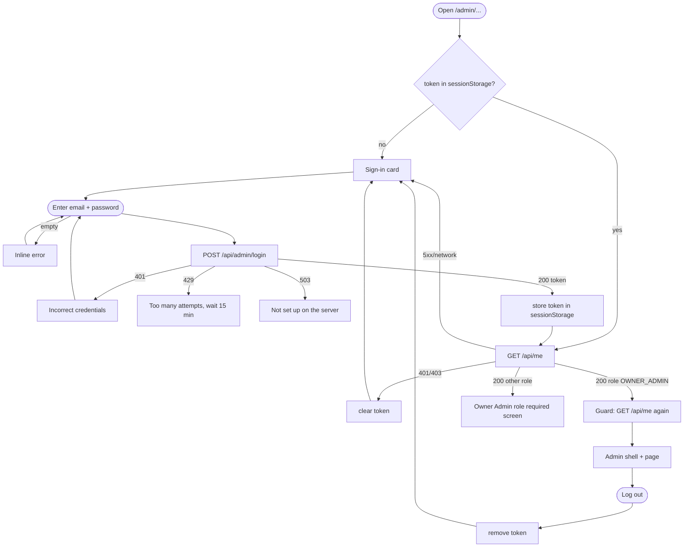
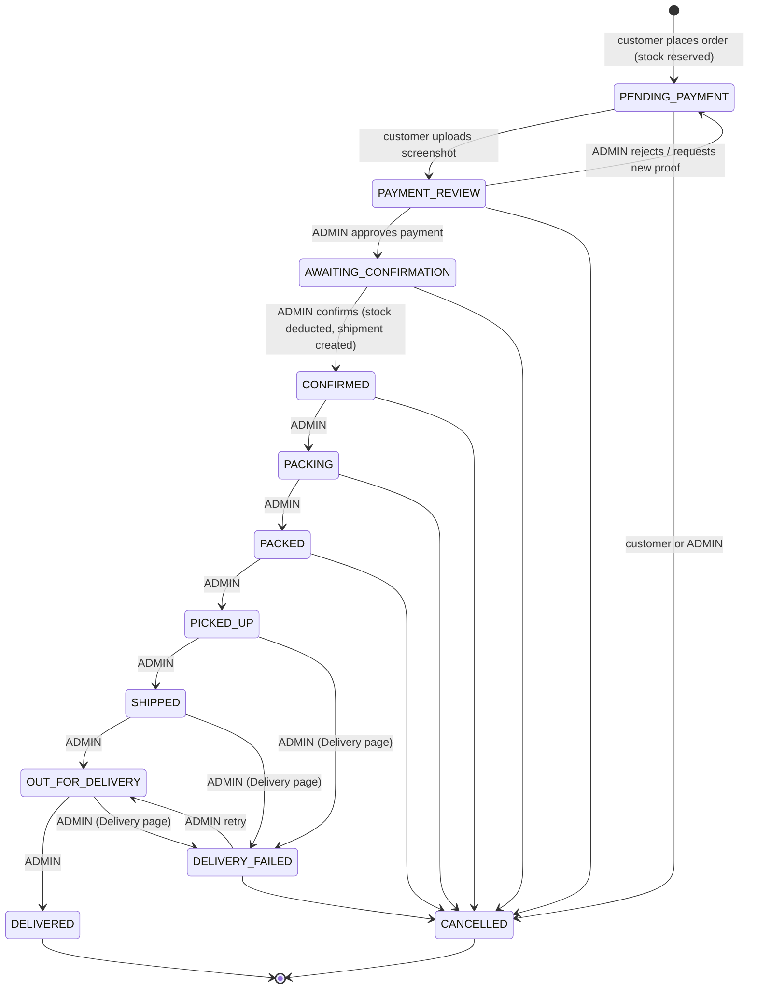
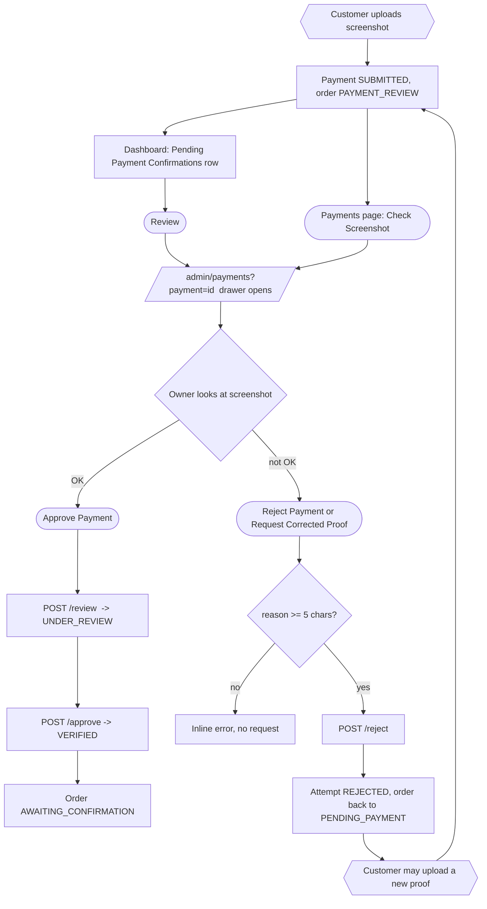
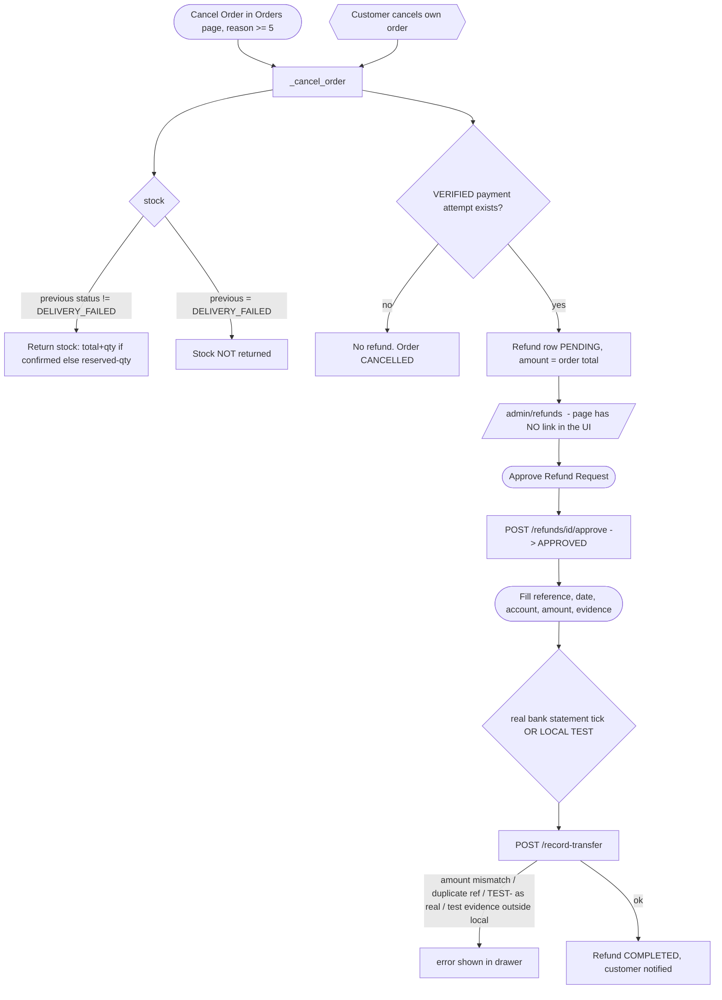
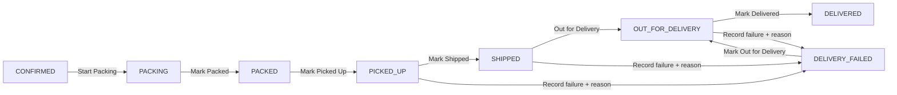
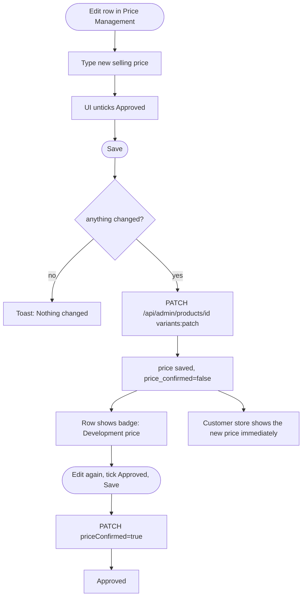
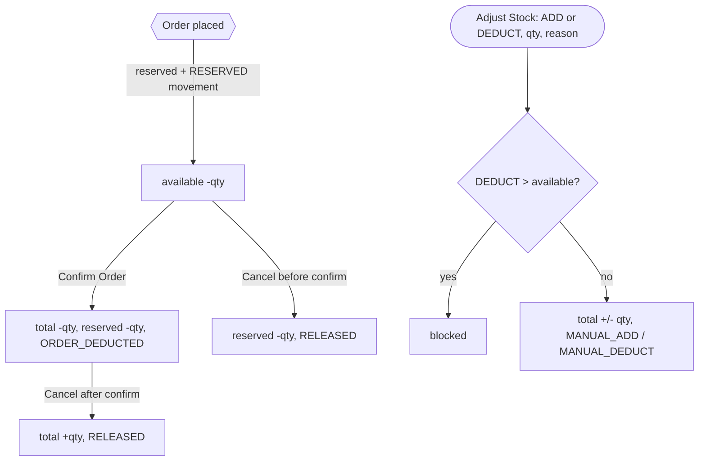
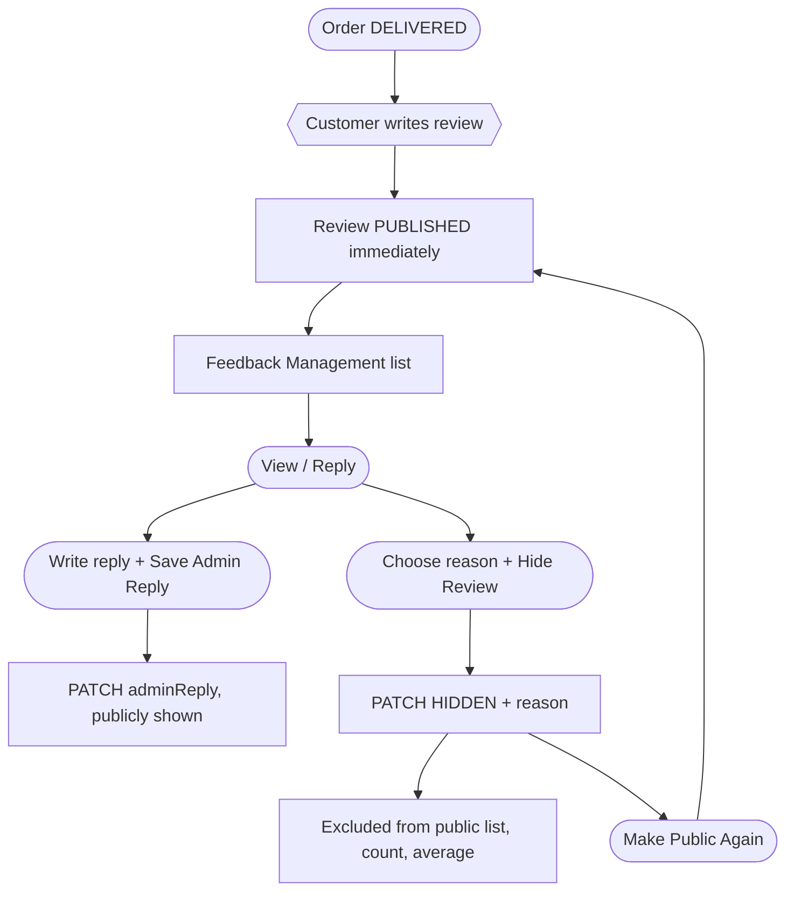
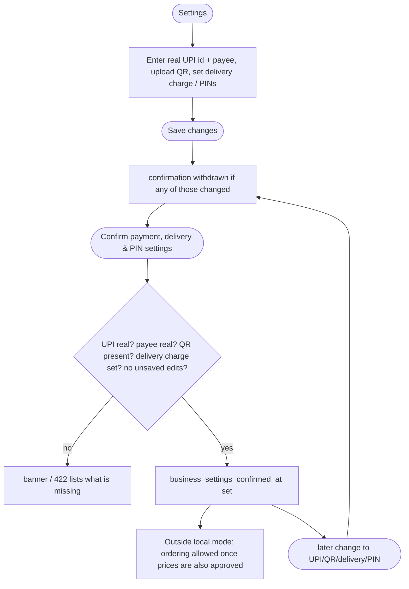

# 04 — Admin Workflows (as implemented)

Each workflow lists: start · trigger · steps · inputs/conditions · status changes · backend requests · database updates · result · error/alternative paths · screenshots · source. Steps are taken from the code and were walked through in the isolated local copy (see `07`). The word **DEMO** marks anything that is test-environment only. **No workflow in this panel moves real money**; payment approval and refund completion only record the owner's own check.

Legend for the diagrams: rectangles = automatic/system, rounded = admin action, hexagons = customer action (outside the admin panel).

---

## W-01 Sign in → work → sign out

- Status changes: none (stateless token, 12 h). DB: `user_profiles` row for the admin e-mail is created/promoted on login and on each token use.
- Alternative: tampered token → `/api/me` 401 → cleared → sign-in (tested). Session end after 12 h shows server error text on the next page action.
- Screenshots: `login__empty-form`, `login__validation-empty`, `login__wrong-password`, `guard__*`, `auth__after-logout`. Source: `AdminRouteGuard.tsx`, `AdminSignIn.tsx`, `lib/auth.ts`, `API/admin.py`.

---

## W-02 Order life cycle (end-to-end, with the admin's part)

- **Start**: a customer order appears in Orders/Dashboard (admin does not create orders — there is no "new order" control).
- **Admin steps**: Payments → approve (W-03) → Orders → *Confirm Order* → *Start Packing* → *Mark Packed* → *Mark Picked Up* → *Mark Shipped* → *Mark Out for Delivery* → *Mark Delivered* (Orders page) — or the same stages through the Delivery page (W-05).
- **Conditions**: payment VERIFIED for everything from CONFIRMED on; one stage at a time; reason ≥ 5 chars for cancel/failure.
- **Backend**: `POST /api/admin/orders/{id}/confirm`; `PATCH /api/admin/orders/{id}/status`; `PATCH /api/admin/deliveries/{id}`.
- **DB updates per step**: `orders.status/delivery_status`, `shipments`, `delivery_events`, `order_status_history`, `admin_audit_logs`; confirm also `product_variants`, `inventory_movements`, `customers`, `notifications`.
- **Result**: DELIVERED order counts in the dashboard (Products Sold, Net Profit) and becomes reviewable by the customer (W-08). Customer sees each step in tracking.
- **Errors**: invalid jump → 409 toast (UI normally hides the button); insufficient stock at confirm → 409 "Insufficient stock to confirm …"; network error → toast, nothing changed.
- **Screenshots**: `orders__populated`, `orders__dialog-confirm-order`, `orders__after-confirm-toast`, `orders__after-state-changes`, `delivery__populated`.
- **Source**: `AdminOrdersPage.tsx`, `orderStateMachine.ts`, `API/admin_orders.py`, `core/domain.py`.
- **Real vs demo**: all real application behaviour; the data in the test run was DEMO.

---

## W-03 Payment verification

- **Inputs**: optional note (≤ 500) for approve; reason (5–500) for reject; the owner's visual judgement of the image.
- **Status changes**: payment `SUBMITTED → UNDER_REVIEW → VERIFIED` (or `→ REJECTED`); order `PAYMENT_REVIEW → AWAITING_CONFIRMATION` (or `→ PENDING_PAYMENT`, `payment_status PENDING`).
- **DB**: `payment_attempts`, `orders`, `order_status_history`, `admin_audit_logs`, `notifications`.
- **Result**: customer notified in-app; after approval the order still needs the separate *Confirm Order* click (never auto-confirmed).
- **Alternative**: re-approving a VERIFIED payment → 409 (or the stored record when an Idempotency-Key is sent). Image not loadable (storage down) → the signed URL returns 503/404; the approve button is gated only on the URL string existing, not on the image having loaded.
- **Screenshots**: `dashboard__review-link-opens-payment-drawer`, `payments__drawer-submitted`, `payments__drawer-reject-validation`, `payments__screenshot-expanded`, `payments__after-approve`, `payments__after-request-corrected-proof`, `payments__drawer-verified`, `payments__drawer-rejected`.
- **Source**: `AdminPaymentsPage.tsx`, `API/admin_payments.py`.
- **DEMO note**: the screenshot images are synthetic placeholders labelled "DEMO IMAGE – NOT A REAL PAYMENT".

---

## W-04 Cancellation and refund

- **Status changes**: order → CANCELLED (final); refund `PENDING → APPROVED → COMPLETED`.
- **DB**: `orders`, `order_status_history`, `product_variants`, `inventory_movements (RELEASED)`, `refunds`, `notifications`, `admin_audit_logs`.
- **Result/impact**: customer counters are **not** reduced; completed refund affects Net Profit only for delivered orders (never happens, see R-DASH-02).
- **Alternative**: cancelling an unpaid order creates no refund. Real money is moved by the owner outside the system.
- **Screenshots**: `orders__dialog-cancel-order`, `orders__drawer-cancelled-refunded`, `refunds__populated`, `refunds__drawer-pending`, `refunds__transfer-needs-settlement-check`, `refunds__after-approve`, `refunds__after-complete`, `refunds__drawer-completed`.
- **Source**: `common.py:_cancel_order`, `API/admin_orders.py:709-872`, `AdminRefundsPage.tsx`.

---

## W-05 Delivery / fulfilment

- **Start**: Delivery page (reachable only by URL) → *Manage* on a row.
- **Steps**: optionally fill rider, phone, courier ref, dates, notes → press the stage button (status + metadata in one PATCH) **or** press *Save Delivery Metadata* (metadata only).
- **Backend**: `PATCH /api/admin/deliveries/{shipment id or order id}`. **DB**: `shipments`, `delivery_events`, `orders`, `order_status_history`, `admin_audit_logs`.
- **Errors**: invalid next stage → toast; failure without 5-char reason → toast; cancelled order → 409.
- **Screenshots**: `delivery__populated`, `delivery__drawer-out-for-delivery`, `delivery__failure-reason-validation`, `delivery__after-record-failure`, `delivery__after-advance-with-metadata`, `delivery__drawer-delivery-failed`.
- **Source**: `AdminDeliveryPage.tsx`, `API/admin_orders.py:556-706`.

---

## W-06 Price change and approval

- **Conditions**: price ≥ 0; approving requires a price. Existing orders keep their own price. Outside local mode customers cannot order a pack whose price is not approved.
- **DB**: `product_variants`, `admin_audit_logs`. **Result**: public `GET /api/products` returns the new price with `priceConfirmed:false` until approved (tested).
- **Variants**: availability toggle (On sale) uses the same path; per-kg row (typed amounts) uses `pricePerKg/costPerKg`.
- **Screenshots**: `prices__row-edit-mode`, `prices__row-edit-changed-price`, `prices__after-save-development-price`, `prices__availability-off-sale`, `prices__typed-amount-row-edit`, `prices__row-validation-toast`.
- **Source**: `AdminProductsPage.tsx`, `API/admin_catalog.py:105-192`.

---

## W-07 Stock adjustment (and automatic stock movement)

- **Admin part**: Inventory → Adjust Stock → form → `POST /api/admin/inventory/adjustments`. **DB**: `product_variants.total_stock`, `inventory_movements`, `admin_audit_logs`. **Result**: movement history and cards refresh; storefront `inStock` follows `available > 0`.
- **Screenshots**: `inventory__populated`, `inventory__low-stock-filter`, `inventory__adjust-drawer`, `inventory__adjust-over-deduct-blocked`, `inventory__after-adjustment`.
- **Not implemented**: automatic release of expired reservations; per-variant threshold editing.

---

## W-08 Review moderation

- **Conditions**: hide needs a reason category (UI) / ≥ 3 chars (server). **DB**: `reviews`, `admin_audit_logs`. **Screenshots**: `feedback__populated`, `feedback__filter-rating-1`, `feedback__drawer-moderation`, `feedback__drawer-review-with-photo`, `feedback__drawer-after-hide`. **Source**: `AdminReviewsPage.tsx`, `API/admin.py:229-299`.

---

## W-09 Go-live confirmation of payment/delivery settings

- **DB**: `store_settings`, `admin_audit_logs`; storage objects for QR/photos. **Screenshots**: `settings__populated`, `settings__validation-pin-error`, `settings__after-qr-upload`, `settings__confirmed`, `settings__after-shop-photo`. **Source**: `AdminSettingsPage.tsx`, `API/admin.py:457-724`.
- **Not exercised**: the real ordering gate (needs a non-local environment).

---

## W-10 Product details and photos

Edit `<product> details & photos` drawer → change text / visibility / information fields → **Save** (`PATCH`, only changed fields) · photo **upload** (immediate `POST`) · photo **Remove** (immediate `DELETE`). DB: `products`, `product_images`, storage objects, audit. Customer product page reads the same data. Screenshots: `prices__product-details-drawer`, `prices__product-drawer-after-photo-upload`. Source: `AdminProductsPage.tsx`, `API/admin_catalog.py`.

---

## W-11 Customer lookup (read only)

URL `/admin/customers` → search / status filter / page → **View** → drawer (contact, address, orders with links to `/admin/orders?q=<number>`, reviews). No writes. Screenshots: `customers__populated`, `customers__filter-repeat`, `customers__search-no-results`, `customers__drawer-detail`.

---

## W-12 Global search shortcut

Header search → `/admin/orders?q=…` → Orders page initial search value. Works when navigating from another page; **does not update an already open Orders page** (verified). Screenshots: `header__global-search-result`, `header__global-search-same-page`.

---

## Workflows the panel does **not** support (no code path)
Creating or editing orders by hand; editing customers; sending messages/e-mails/SMS; exporting data or reports; viewing the audit log or notifications; multi-user roles (there is exactly one fixed admin); changing the admin password (server environment variables only); automatic payment matching; automatic expiry of unpaid orders.
