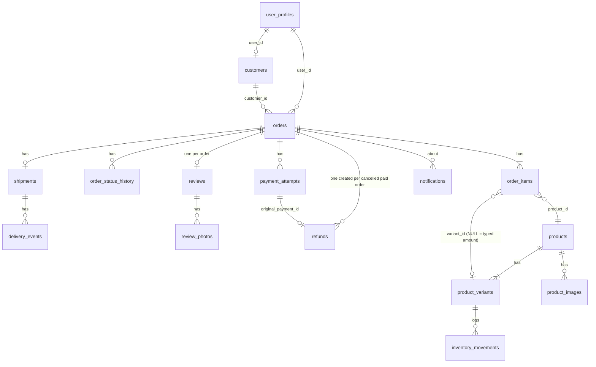

# 06 — Technical Architecture (current)

No secrets, connection strings or credentials appear in this document. Environment variables are named, never valued.

## 1. Big picture

```mermaid
flowchart LR
  subgraph Browser
    ST[Storefront SPA\nfrontend/ - Vite + React 19]
    AD[Admin Panel SPA\nadmin-panel/ - Vite + React 19]
  end
  subgraph Vercel
    SV[Project 1: storefront static + /api -> api/index.py\n(root vercel.json)]
    AV[Project 2: admin static; rewrites /api/* and /images/* to the store domain\n(admin-panel/vercel.json)]
    FN[FastAPI app\nbackend/app, ASGI via api/index.py]
  end
  subgraph Neon
    PG[(Postgres\nschema = backend/migrations/neon/*.sql)]
    NA[Neon Auth\nEdDSA JWT + JWKS]
    OS[(Object Storage\nprivate bucket 'assets')]
  end
  ST -->|/api| FN
  AD -->|/api via rewrite| FN
  FN --> PG
  FN --> OS
  ST --> NA
  FN -. verifies customer JWT .-> NA
```
- The Admin Panel is a **separate, self-contained Vite app** (own `package.json`, no imports from `frontend/`). It talks to the **same FastAPI backend and database** as the store.
- Admin identity does **not** use Neon Auth: one fixed login whose credentials live in server environment variables.

## 2. Frontend (Admin Panel)

| Item | Value (source) |
|---|---|
| Framework | React ^19.0.0, react-dom ^19, **react-router-dom ^7.1** (`admin-panel/package.json`) |
| Language/build | TypeScript ~5.6 (strict), Vite ^6 + `@vitejs/plugin-react`; manual chunks `vendor-react` / `vendor` (`vite.config.ts`) |
| Dev server | port **5174**; proxies `/images/products` and `/images/hero-product.jpg` to the store dev server on 5173 (product photos are `/images/…` paths owned by the storefront) |
| Entry | `src/main.tsx` → `BrowserRouter` → `app/App.tsx` routes under `/admin` |
| State management | local `useState` per page; one tiny external store for the session (`lib/auth.ts`, `useSyncExternalStore`); a React context for toasts. No Redux/Query/SWR. No data cache |
| Styling | plain CSS: `src/styles/globals.css` (design system, shared with storefront) + `features/admin/styles/admin.css` |
| HTTP | `lib/api.ts:apiFetch` (fetch + 15 s timeout + bearer token); typed wrappers in `features/admin/api/index.ts` |
| Types | `features/admin/types/index.ts` (776 lines), `src/types/orders.ts` |
| Config | `VITE_API_BASE_URL`, `VITE_STORE_URL`, `VITE_ADMIN_URL`, `VITE_SUPPORT_WHATSAPP`, `VITE_NEON_AUTH_URL` — all public (shipped to the browser). Admin code reads only the first four via `src/lib/env.ts`; `supportWhatsApp` and `adminUrl` are defined there but not used by any admin file, and `VITE_NEON_AUTH_URL` is not read at all (the storefront uses `VITE_ADMIN_URL` for its "Admin Panel" link) |
| Tests | `tests/admin.test.mjs` — Node script that compiles and exercises TypeScript sources (state machine, route guard, API client, nav, minimal dashboard); passes (see `07`) |

Major components: `AdminLayout` (shell) · `AdminRouteGuard` (server-role gate) · `AdminSidebar`, `AdminHeader` · 10 page components · shared `StatusBadge`, `StatCard`, `DetailDrawer`, `ConfirmDialog`, `ImagePreview`, `AdminTimeline`, `Toast`, `AdminStates` · `lib/orderStateMachine.ts` (client copy of order/payment/refund/stock rules + unused profit helpers) · `lib/referenceData.ts` (sample data used only by the unrouted Notifications page).

## 3. Backend

| Item | Value |
|---|---|
| Framework | FastAPI 0.136.1, Starlette 1.0.0, Pydantic 2.13.4 (strict `extra="forbid"` request models), SQLAlchemy 2.0.49, psycopg 3.3.6, PyJWT 2.10.1, boto3 1.43.115 (`backend/requirements.txt`, Python 3.13 per `.python-version`) |
| Entry | `backend/app/main.py` (`create_app`) mounted at `/api` **and** `/`; on Vercel `api/index.py` imports it and returns a 503 JSON explaining startup failures |
| CORS | allowed origins from `CORS_ORIGINS` (defaults to localhost 5173/5174); methods GET/POST/PATCH/PUT/DELETE/OPTIONS; headers Authorization, Content-Type, Accept, Idempotency-Key |
| Layers | `routes/` (HTTP + business logic mixed per handler) · `core/domain.py` (state machines, money helpers) · `core/security.py` (JWT + admin token) · `core/storage.py` (object storage + signed URLs) · `db/` (models, session, seed) |
| Config | `core/config.py` loads `.env.local`/`.env` files (root and backend) only for variables not already set; `BFP_ENV` (`local` enables dev conveniences, default `production`) |
| Tests | 110 `unittest` tests in `backend/tests/` on SQLite |
| Migrations | `backend/migrations/neon/001…005.sql` applied by `scripts/setup-neon-db.py`; on PostgreSQL the app never creates tables, on SQLite (tests/local) `Base.metadata.create_all` does |

## 4. Authentication and admin access control

- **Admin session**: `POST /api/admin/login` → HMAC token (`adm1.<payload>.<sig>`, 12 h) derived from `ADMIN_EMAIL`, `ADMIN_PASSWORD`, `PROOF_SIGNING_SECRET` (all server-side). Browser keeps it in `sessionStorage`. Login throttle: 10 failures / 15 min / process.
- **Customer sessions**: Neon Auth (EdDSA JWT, JWKS cache, issuer/audience check); profile linked via `user_profiles.auth_subject`; `neon_auth."user"` is queried to require a verified, non-banned e-mail.
- **Authorisation**: `principal_from_authorization` accepts either token type; `get_owner_admin_principal` requires `role == OWNER_ADMIN` from `user_profiles` (never from token claims). All `/api/admin/*` handlers except image GETs declare it as a dependency.
- **Frontend gate**: `AdminRouteGuard` asks `GET /api/me`; this is defence-in-depth, not the security boundary.
- **Single role**: only `OWNER_ADMIN` and `CUSTOMER` exist; the admin panel has no user management.

## 5. Admin API endpoints (all under `/api`, all require OWNER_ADMIN unless noted)

| Method + path | Handler | Used by (UI) |
|---|---|---|
| POST `/admin/login` (public) | `admin.py:admin_login` | Sign-in |
| GET / PATCH `/me` (any signed-in user) | `account.py` | guard, profile modal |
| GET `/admin/dashboard` | `admin.py:get_admin_dashboard` | Dashboard |
| GET `/admin/orders` · GET `/admin/orders/{id}` | `admin_orders.py` | Orders (detail GET unused by UI; list returns details) |
| POST `/admin/orders/{id}/confirm` · PATCH `/admin/orders/{id}/status` | `admin_orders.py` | Orders |
| GET `/admin/payments` · GET `/admin/payments/{id}` | `admin_payments.py` | Payments (detail GET unused) |
| GET `/admin/payments/{id}/proof` (signed link or admin bearer) | `admin_payments.py` | Payments image / link refresh |
| POST `/admin/payments/{id}/review` · `/approve` · `/reject` | `admin_payments.py` | Payments |
| GET `/admin/products` · PATCH `/admin/products/{id}` | `admin_catalog.py` | Price Management |
| POST `/admin/products/{id}/images` · DELETE `…/images/{imageId}` | `admin_catalog.py` | product drawer |
| GET `/admin/inventory` · POST `/admin/inventory/adjustments` | `admin_catalog.py` | Inventory |
| GET `/admin/deliveries` · PATCH `/admin/deliveries/{id}` | `admin_orders.py` | Delivery |
| GET `/admin/customers` · GET `/admin/customers/{id}` | `admin.py` | Customers |
| GET `/admin/reviews` · PATCH `/admin/reviews/{id}` · GET `/admin/reviews/photos/{id}` (signed/bearer) | `admin.py` | Feedback |
| GET `/admin/refunds` · POST `…/{id}/approve` · POST `…/{id}/record-transfer` | `admin_orders.py` | Refunds |
| GET / PATCH `/admin/settings` · POST `/admin/settings/confirm` · POST/GET `/admin/settings/qr` · POST `/admin/settings/photos` · DELETE `/admin/settings/photos/{id}` | `admin.py` | Settings |
| **Called by code but missing**: GET `/admin/reports`, GET `/admin/notifications`, POST `/admin/notifications/{id}/retry` | — (404) | unrouted pages |

Customer/public endpoints the admin data feeds: `GET /products`, `/products/{slug}`, `/store`, `/reviews`, `/health`, `POST /checkout/quote`, `/orders`, `/orders/{id}`, `/orders/{id}/tracking|cancel|review|payment-qr`, `/payments/{id}/submit|status`.

## 6. Database (PostgreSQL in production, SQLite in tests/local)

Tables (SQLAlchemy models `backend/app/db/models.py`; production DDL in `migrations/neon/`): `user_profiles`, `customers`, `products`, `product_images`, `product_variants`, `store_photos`, `store_settings` (single row id=1), `orders`, `order_items`, `order_status_history`, `payment_attempts`, `bank_credits` (unused), `inventory_movements`, `shipments`, `delivery_events`, `reviews`, `review_photos`, `refunds`, `notifications` (write-only), `admin_audit_logs` (write-only).


Notable columns: money in `*_paise` BigInteger; `product_variants.total_stock/reserved_stock/low_stock_threshold/price_confirmed/is_available`; `orders.stock_deducted`, `stock_reservation_expires_at`; `store_settings.business_settings_confirmed_at`, `serviceable_pin_codes` (JSON/jsonb), `qr_code_storage_path`; `payment_attempts.screenshot_storage_path`, `submitted_utr/verified_utr` (unused). Migration 005 adds typed amounts (per-kg price/cost and nullable `order_items.variant_id`).

## 7. File uploads and storage

- Types: JPEG/PNG/WEBP only; content must match the declared MIME by magic bytes. Limits: request 4 MB (Vercel body limit comment), QR 2 MB, product photos ≤ 10/product, shop photos ≤ 20, review photos ≤ 5.
- Objects live in one private bucket `assets` under prefixes `payment-proofs/`, `review-photos/`, `product-images/`, `store-photos/`, `payment-qr/` (S3 API via boto3, path-style addressing, `IfNoneMatch="*"` so objects are never overwritten).
- Private images (payment proofs, review photos, QR) are served only by the API with an HMAC-signed short-lived link or an admin bearer. Catalogue and shop photos are served through 1-hour pre-signed S3 URLs. Bundled photos (`/images/…`) are static files of the storefront.
- Orders reference `/images/products/*` which the admin dev server proxies and the admin Vercel project rewrites to the store domain.

## 8. Integration with the customer-facing site

Shared database and API only (see `03_ADMIN_LOGIC.md` §0.5). The Admin Panel contains two links to the store (`VITE_STORE_URL`); the storefront shows an "Admin Panel" link to the owner using `VITE_ADMIN_URL`. There are no websockets, push channels, e-mail or SMS integrations: notifications are database rows.

## 9. Third-party services actually configured

| Service | Evidence |
|---|---|
| Neon Postgres | `DATABASE_URL`, `neon.ts` (`auth: true`, bucket `assets` private), migrations |
| Neon Auth (customers) | `NEON_AUTH_BASE_URL`, `NEON_AUTH_JWKS_URL`, `core/security.py` |
| Neon Object Storage (S3) | `AWS_ENDPOINT_URL_S3`, `AWS_ACCESS_KEY_ID`, `AWS_SECRET_ACCESS_KEY`, `AWS_REGION` |
| Vercel (two projects) | `vercel.json`, `admin-panel/vercel.json`, `api/index.py` |
| Google Fonts | `<link>` in `admin-panel/index.html` |
| WhatsApp number (storefront link) | `VITE_SUPPORT_WHATSAPP` |
No payment gateway, e-mail provider, SMS, analytics or error-tracking service is configured.

## 10. Feature → source mapping

| Feature | Frontend | Backend | Tables |
|---|---|---|---|
| Sign-in / session | `AdminSignIn.tsx`, `AdminRouteGuard.tsx`, `lib/auth.ts` | `admin.py:admin_login`, `security.py`, `account.py:get_me` | `user_profiles` |
| Profile | `AdminHeader.tsx`, `lib/profile.ts` | `account.py:update_me` | `user_profiles`, `customers` |
| Dashboard | `AdminDashboardPage.tsx` | `admin.py:get_admin_dashboard` | `orders`, `order_items`, `refunds`, `payment_attempts` |
| Orders | `AdminOrdersPage.tsx`, `orderStateMachine.ts` | `admin_orders.py` (list/confirm/status), `common.py:_cancel_order`, `domain.py` | `orders`, `order_items`, `order_status_history`, `shipments`, `delivery_events`, `product_variants`, `inventory_movements`, `customers`, `refunds`, `notifications` |
| Payments | `AdminPaymentsPage.tsx`, `ImagePreview.tsx` | `admin_payments.py`, `storage.py` | `payment_attempts`, `orders`, `order_status_history`, `notifications` |
| Price Management | `AdminProductsPage.tsx` | `admin_catalog.py` (products/images) | `products`, `product_variants`, `product_images` |
| Inventory | `AdminInventoryPage.tsx` | `admin_catalog.py` (inventory) | `product_variants`, `inventory_movements` |
| Delivery | `AdminDeliveryPage.tsx` | `admin_orders.py` (deliveries) | `shipments`, `delivery_events`, `orders`, `order_status_history` |
| Customers | `AdminCustomersPage.tsx` | `admin.py` (customers) | `customers`, `orders`, `reviews`, `user_profiles` |
| Feedback | `AdminReviewsPage.tsx` | `admin.py` (reviews) | `reviews`, `review_photos` |
| Refunds | `AdminRefundsPage.tsx` | `admin_orders.py` (refunds) | `refunds`, `payment_attempts`, `notifications` |
| Settings | `AdminSettingsPage.tsx` | `admin.py` (settings, qr, photos) | `store_settings`, `store_photos` |
| Audit trail (write-only) | — | every admin handler | `admin_audit_logs` |
| Reports / Notifications | `AdminReportsPage.tsx`, `AdminNotificationsPage.tsx`, `referenceData.ts` (unrouted) | none | — |

## 11. Repository facts relevant to the snapshot

- Git HEAD `0a69f7e` ("deleviry and payment method added") plus **uncommitted working-tree changes** in 18 tracked files at the start of this session (listed in the README); one more admin file (`AdminSettingsPage.tsx`) was edited by someone else **while this documentation was being produced**. All statements describe the working tree as of the end of the session.
- Deployment: two Vercel projects (store + API; admin with `admin-panel` root). Live database target per the project's own notes is a Neon production branch; this documentation did **not** touch it.
