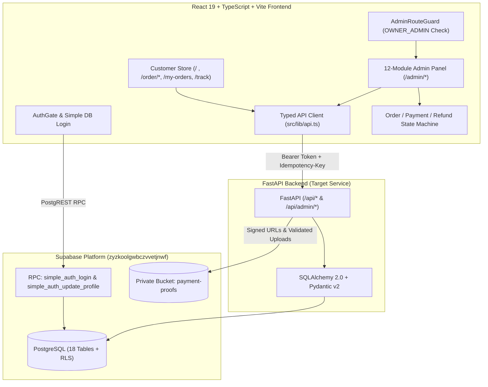

# System Architecture — Balaji Faki Point

## 1. Overview

**Balaji Faki Point** is a full-stack e-commerce ordering and administration platform for traditional Kathiyawadi Faki and Supari, featuring a manual UPI QR payment verification workflow and a 12-module Owner Admin Management Panel.

---

## 2. Frontend Architecture (`src/`)

- **Entry & Routing**:
  - [`src/main.tsx`](../../src/main.tsx) → mounts [`src/app/App.tsx`](../../src/app/App.tsx) inside `<BrowserRouter>`.
  - [`src/app/App.tsx`](../../src/app/App.tsx) → wraps `<AppRouter />` in [`AuthGate`](../../src/components/common/AuthGate.tsx) and account-scoped [`OrderProvider`](../../src/context/OrderContext.tsx).
  - [`src/app/router.tsx`](../../src/app/router.tsx) → defines all Customer routes under [`StoreLayout`](../../src/components/layout/StoreLayout.tsx) and all 12 Admin routes under [`AdminLayout`](../../src/components/layout/AdminLayout.tsx).
- **Customer Feature Modules**:
  - `src/features/catalog` — Home & 404 pages, catalog API.
  - `src/features/orders` — Order form, review order, confirmation, my orders, and order tracking.
  - `src/features/payments` — Official UPI QR display, UTR + screenshot submission, verification polling, and payment flow guide.
  - `src/features/reviews` — Customer reviews & feedback form with Gujarati/English validation.
  - `src/features/store` & `src/features/help` — Store location/contact and searchable Help & FAQs.
- **Admin Panel Feature Module (`src/features/admin/`)**:
  - `pages/` — 12 operational modules (`AdminDashboardPage`, `AdminOrdersPage`, `AdminPaymentsPage`, `AdminProductsPage`, `AdminInventoryPage`, `AdminDeliveryPage`, `AdminCustomersPage`, `AdminReviewsPage`, `AdminRefundsPage`, `AdminReportsPage`, `AdminNotificationsPage`, `AdminSettingsPage`).
  - `lib/orderStateMachine.ts` — Deterministic transition and validation guards enforcing payment/order separation, duplicate UTR prevention, stock bounds, and refund verification.
  - `api/index.ts` — Typed FastAPI client functions for all 24 administrative endpoints.
  - `components/` — Reusable UI primitives (`AdminHeader`, `AdminSidebar`, `AdminRouteGuard`, `StatusBadge`, `StatCard`, `ConfirmDialog`, `DetailDrawer`, `ImagePreview`, `AdminTimeline`, `Toast`, `AdminStates`).

---

## 3. Authentication & Authorization Architecture

- **Database-Backed Login (No Email Confirmation Delay)**:
  - [`src/lib/supabase.ts`](../../src/lib/supabase.ts) calls `public.simple_auth_login(p_email, p_password)` on Supabase PostgreSQL (`zyzkoolgwbczvvetjnwf`).
  - If the email is **not in `public.user_profiles`**, the database creates the account (`role = 'CUSTOMER'`, bcrypt password hash via `pgcrypto`) and logs the user in immediately.
  - If the email **is in `public.user_profiles`**, the database verifies the password hash and returns the user profile and role (`CUSTOMER` or `OWNER_ADMIN`).
- **Role Separation**:
  - `CUSTOMER` accounts cannot access `/admin/*` (`evaluateAdminRouteAccess` denies access).
  - `OWNER_ADMIN` accounts (e.g., `dp334218@gmail.com`) unlock all 12 `/admin/*` modules.

---

## 4. Monetary & State Machine Integrity

- **Monetary Representation**: All database monetary columns (`price_paise`, `subtotal_paise`, `delivery_fee_paise`, `total_paise`, `expected_amount_paise`, `credited_amount_paise`, `refund_amount_paise`) use 64-bit integer `paise` (`bigint`) to prevent floating-point rounding errors.
- **Payment vs. Order Confirmation Separation**:
  - Approving a payment sets `payment_status = 'VERIFIED'` and `order.status = 'AWAITING_CONFIRMATION'`.
  - Confirming an order (`AWAITING_CONFIRMATION` → `CONFIRMED`) is a separate administrative action that verifies available stock.
  - Packing (`CONFIRMED` → `PACKING`) is blocked both in the UI state machine and by the PostgreSQL constraint `orders_confirmed_requires_verified_payment` unless `payment_status = 'VERIFIED'`.
